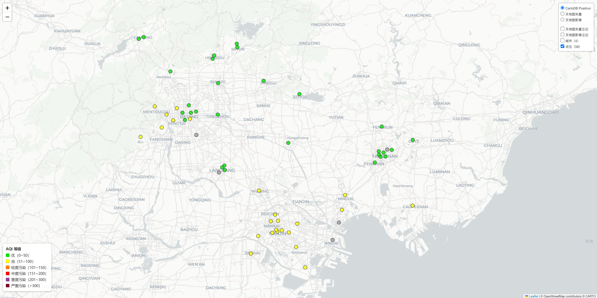
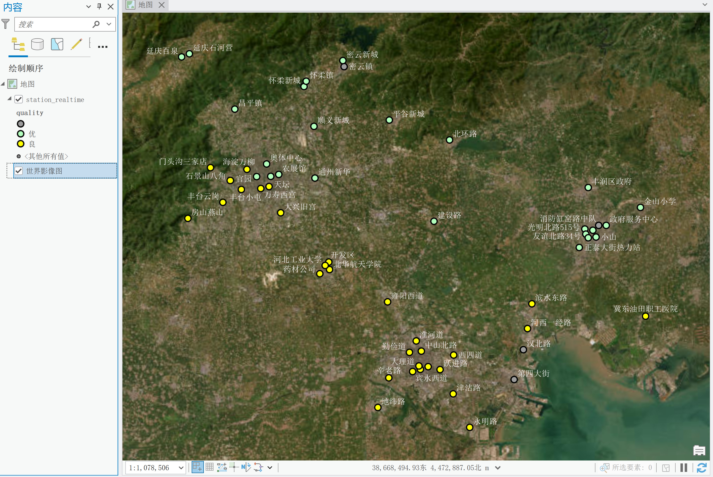

# cnemc-air

中国环境监测总站空气质量数据获取工具：给定一个城市，抓取**城市级**与**点位级**的实时与历史空气质量数据（AQI、PM2.5、PM10、SO₂、NO₂、CO、O₃ ），输出 **CSV / JSON / GeoPackage / Shapefile / 天地图底图交互 HTML**。矢量数据属性表包含全部抓取字段，坐标统一 WGS-84。

**数据来源：中国环境监测总站空气质量发布平台 `https://air.cnemc.cn:18007`。**





## 特性

- **城市级 + 点位级一体**：一次运行同时抓取城市实时六参数、城市近 24 小时、城市近 14 天日报，以及该城市全部点位的实时与近 24 小时数据。
- **多城市一次抓取**：`cities` 列表或 `--city 北京,上海` 一次抓取多个城市，按城市子目录组织产物并生成多城市汇总地图；单城市失败不中断，支持断点续跑。
- **多格式导出**：CSV / JSON / GeoPackage（城市级 `city.gpkg` 三图层 + 点位级 `station.gpkg` 两图层）/ Shapefile（一图层一文件）。
- **天地图交互地图**：folium + 天地图矢量/影像底图，城市与点位按 AQI 国标配色，popup 显示完整指标，自包含单文件 HTML。
- **健壮采集**：限速 + 指数退避重试、`Content-Type` 与时间戳校验、缺失值规范化、原始响应落盘审计。
- **轻依赖**：核心仅 `requests` / `pyyaml` / `folium`；GPKG/SHP 导出走可选 `geopandas`。

## 安装

```bash
git clone https://github.com/Urbankernel/cnemc-air.git
cd cnemc-air
pip install -r requirements.txt        # 或 pip install .
```

要求 Python ≥ 3.9。需要导出 GPKG/SHP 时再装可选依赖：

```bash
pip install -r requirements-optional.txt   # geopandas
```

## 准备工作

1. 本数据源无需 API key。
2. 可选：交互地图默认用**天地图**底图，免费到[天地图控制台](https://console.tianditu.gov.cn/)申请 tk；无 tk 时降级 CartoDB Positron（CartoDB 现也需 key，免费申请 https://carto.com/basemaps/apikey/）。
3. 城市名直接用平台名称（如「北京市」），或用 `cnemc-air cities` 查询城市编码。

## 配置

1. 复制模板为 `configs/config.yaml`：

```bash
# Linux / macOS
cp configs/example.yaml configs/config.yaml
# Windows
copy configs\example.yaml configs\config.yaml
```

2. 打开 `configs/config.yaml` 填写自己的参数。

`cnemc-air run` **默认读取 `configs/config.yaml`**，无需 `-c`；如需其它路径可用 `-c` 指定。关键字段：

| 字段 | 说明 | 默认 |
|------|------|------|
| `city.name` / `city.code` | 单城市：城市名或编码（code 优先） | 二选一必填 |
| `cities` | 多城市列表（每项 `name`/`code` 或城市名字符串，优先于 `city`） | 可选 |
| `fetch.city` | 城市级实时/近24小时/近14天日报 | true |
| `fetch.stations` | 点位级实时 | true |
| `fetch.station_history` | 逐点位近24小时（点位数越多耗时越长） | true |
| `request.qps` | 每秒请求数上限 | 1.0 |
| `request.max_retries` | 单请求网络异常/限流最大重试次数（指数退避） | 5 |
| `request.retry_base_seconds` | 退避基数（等待 = base × 2^n + 抖动） | 1.0 |
| `request.timeout` | 单次请求超时（秒） | 30.0 |
| `request.sleep_between_stations` | 逐点位采集间隔（秒） | 1.0 |
| `request.verify` | TLS 证书校验（极少数网络环境证书链不完整时置 false） | true |
| `outputs.dir` | run 目录根 | runs |
| `outputs.csv` / `.json` / `.gpkg` / `.shp` / `.html` / `.raw` | 产物开关 | 除 shp 外均 true |
| `viz.basemap` | `tianditu` / `cartodb` | tianditu |
| `viz.tianditu_tk` | 天地图 tk（也可走 `key_file` 的 `tk=` 行或环境变量 `TIANDITU_TK`） | "" |
| `viz.carto_key` | CartoDB 底图 key（也可走 `key_file` 的 `carto=` 行或环境变量 `CARTO_KEY`） | "" |

> **输出格式说明**：命令行参数（如 `--city`）只覆盖目标城市，不会改变输出格式；csv / json / gpkg / shp / html / raw 等产物开关始终由配置文件的 `outputs` 段决定。若未改动配置，输出格式即 `configs/example.yaml` 的默认值（csv / json / gpkg / html / raw 开，shp 关）。

## 用法

命令行入口在 `src/cnemc_air/cli.py` 的 `main()`，通过 `pyproject.toml` 注册为 `cnemc-air` 命令。

**方式一：安装后使用 `cnemc-air` 命令（推荐）**

```bash
pip install .
cnemc-air run            # 默认读取 configs/config.yaml
```

**方式二：不安装，用 `python -m` 模块方式（需在项目根目录执行）**

```bash
# Linux / macOS
PYTHONPATH=src python -m cnemc_air run

# Windows PowerShell
$env:PYTHONPATH="src"; python -m cnemc_air run
```

> 注意：不能直接 `python src/cnemc_air/cli.py` 运行（`cli.py` 使用相对导入）。

命令示例：

```bash
# 列出全部城市（编码/名称/经纬度/AQI）
cnemc-air cities
# 列出指定城市（编码/名称/经纬度/AQI）
cnemc-air cities --filter 北京

# 抓取指定城市（默认读取 configs/config.yaml，可用 CLI 参数覆盖）
cnemc-air run
cnemc-air run --city 上海市
cnemc-air run --city-code 440100 --output-dir out

# 一次抓取多个城市
cnemc-air run --city 北京,上海,广州          # 逗号分隔
cnemc-air run --city 北京 --city 上海        # 多次传入
cnemc-air run --cities-file cities.txt       # 清单文件（每行一个城市名/编码）

# 续跑：指定已有 run 目录，跳过已完成城市
cnemc-air run --resume runs/20261117_000000_multi_3

# 指定其它配置文件
cnemc-air run -c configs/example.yaml --city 上海市
```

## 输出

每次运行生成独立 run 目录：

```
runs/20261113_201500_北京市/
├── config.snapshot.yaml       # 配置快照（凭证已脱敏）
├── run.log                    # 完整日志
├── raw/                       # 原始接口响应（审计/字段漂移追溯）
│   ├── city_realtime.json
│   ├── city_hour.json
│   ├── city_day.json
│   ├── stations.json
│   └── station_hour_1001A.json ...
└── outputs/
    ├── city_realtime.csv/.json    # 城市实时（1 行）
    ├── city_hour.csv/.json        # 城市近 24 小时
    ├── city_day.csv/.json         # 城市近 14 天日报
    ├── station_realtime.csv/.json # 全部点位实时
    ├── station_hour.csv/.json     # 全部点位近 24 小时
    ├── city.gpkg                  # 城市级：city_realtime/city_hour/city_day 三图层（点）
    ├── station.gpkg               # 点位级：station_realtime/station_hour 两图层（点）
    ├── city_realtime.shp ...      # Shapefile（outputs.shp: true 时，一图层一文件）
    └── map.html                   # 天地图底图交互地图（自包含单文件）
```

多城市运行（`cities` 列表或 `--city 北京,上海`）时，每个城市一个子目录，根目录 `outputs/` 另放**全量汇总层**：

```
runs/20261113_201500_multi_3/
├── config.snapshot.yaml
├── run.log
├── progress.json                # 各城市状态（done/failed，续跑用）
├── outputs/                     # 汇总层（全量，字段与单城市一致，靠 city_code/city_name 区分城市）
│   ├── city_realtime.csv/.json  # 每城市 1 行
│   ├── city_hour.csv/.json      # 24×城市数 行
│   ├── city_day.csv/.json       # 14×城市数 行
│   ├── station_realtime.csv/.json
│   ├── station_hour.csv/.json
│   ├── city.gpkg                # 城市级 3 图层（点）
│   ├── station.gpkg             # 点位级 2 图层（点）
│   ├── city_realtime.shp ...    # Shapefile（outputs.shp: true 时，一图层一文件）
│   └── map.html                 # 多城市汇总地图
├── 北京市/
│   ├── raw/...
│   └── outputs/  city_realtime.csv ... station.gpkg ... map.html
├── 上海市/
│   └── outputs/ ...
└── 广州市/
    └── outputs/ ...
```

CSV 采用 UTF-8-BOM，Excel 直接打开不乱码；数值已转 float，缺失值置空。

矢量说明：GPKG 属性表字段与 CSV 完全一致；SHP 受 10 字符字段名限制，仅
`station_code→stn_code`、`station_name→stn_name`、`time_point_str→time_pts`、
`primary_pollutant→prim_poll`、`unhealthful→unhealth` 改名（见 `docs/output-fields.md`）。

> **SHP 缺失值注意**：Shapefile 的 `.dbf` 属性表不支持数值 NULL，数值字段的无数据（接口返回 `NA`）在 SHP 里会被写成 0，与真实零值（如 `COLevel: 0`）无法区分。精确缺失语义请使用 **GPKG / CSV / JSON**（CSV 为空、JSON 为 `null`、GPKG 为 `NULL`）。

## 目录结构

```
cnemc-air/
├── configs/example.yaml      # 配置模板（复制为 configs/config.yaml 后使用）
├── src/cnemc_air/
│   ├── cli.py                # 命令行入口（run / cities）
│   ├── config.py             # YAML 加载 + CLI 覆盖 + 校验
│   ├── client.py             # CNEMC 接口封装（限速 + 重试 + 响应校验）
│   ├── pipeline.py           # 采集编排：城市级 + 点位级
│   ├── normalize.py          # 字段规范化（时间/数值/AQI 等级）
│   ├── coords.py             # 可选坐标转换：WGS-84 ↔ GCJ-02 ↔ BD-09（不自动生成派生列）
│   ├── store.py              # run 目录 + 原始响应落盘
│   ├── export.py             # CSV / JSON / GPKG / SHP 导出
│   ├── viz.py                # folium 天地图交互地图
│   ├── retry.py              # 指数退避
│   ├── log.py                # 日志（控制台 + 文件双通道）
│   └── __main__.py           # python -m cnemc_air
├── tests/                    # pytest
└── docs/
    ├── api-reference.md      # 数据源接口参考
    └── output-fields.md      # 输出字段说明
```

## 历史数据说明（重要）

- 城市近 24 小时接口固定返回 **24 条**、近 14 天日报接口固定返回 **14 条**。
- 平台**未暴露任意时间范围查询**。超过窗口的历史数据不能靠这些接口回补，应从开始使用时**持续归档**。
- 单小时全城快照接口仅在近 24 小时窗口内有效，且可能静默回退最新数据，本工具已按返回时间校验。

## 坐标系与合规

- **城市坐标说明**：城市级数据的经纬度取自 `GetAllCityRealTimeAQIModels`，为该市**所有监测点位坐标的平均值/中心点**（并非政府驻地或行政中心坐标）；城市实时详情接口 `GetAQIDataPublishLiveInfo` 本身**不返回经纬度**。点位坐标则来自 `GetAQIDataPublishLive`（每个点位均有坐标）。
- 成果统一 WGS-84（`lon/lat`），不生成 GCJ-02 派生列。天地图底图采用CGCS2000，与 WGS-84米级对齐，交互地图直接叠加。
- 数据为公开环境监测数据，公开展示、再发布或商业使用前请确认网站条款与来源标注要求。
- 请控制请求频率（默认 1 req/s），遵守平台访问约束，勿绕过访问控制。

## License

MIT
